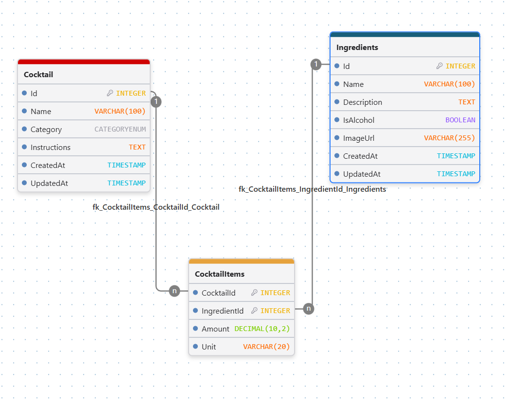

 <div align="center">
  

# Cocktails REST API

**REST API for cocktails, ingredients, and drink recipes.**

  <p>
    
    
    
    
  </p>
</div>

---

Projekt rekrutacyjny na stanowisko Backend w Kole Naukowym **Solvro**.
<br>
Strona: https://solvro.pwr.edu.pl/pl/
<br>
Github: https://github.com/solvro

Aplikacja to w pełni funkcjonalne REST API do zarządzania bazą koktajli i ich składników, zaimplementowane w oparciu o framework **NestJS**, bazę danych **PostgreSQL** oraz ORM **Prisma**.
<br><br>

## Technologie

- **Framework:** NestJS
- **Baza danych:** PostgreSQL
- **ORM:** Prisma
- **Walidacja danych:** `class-validator`, `class-transformer`
- **Dokumentacja API:** Swagger / OpenAPI

<br>

## Schemat bazy danych

</img>

<br>

## Uruchomienie projektu

### Wymagania

- Node.js (wersja 20+ zalecana)
- Zainstalowana i uruchomiona baza PostgreSQL (np. lokalnie lub w kontenerze Docker)
<br>

<br>

```bash
### 1. Klonowanie i instalacja zależności
git clone <URL_REPOZYTORIUM>
cd <NAZWA_KATALOGU>
npm install

### 2. Plik .env

DATABASE_URL="postgresql://postgres:<HASLO>@localhost:5432/cocktail_db?schema=public"

### 3. Migracja bazy danych

npx prisma migrate dev

### 4. Seedowanie bazy danych

npx prisma db seed

### 5. Start aplikacji

npm run start

### 6. Link

Aplikacja - http://localhost:3000
API DOCS - http://localhost:3000/api

```
