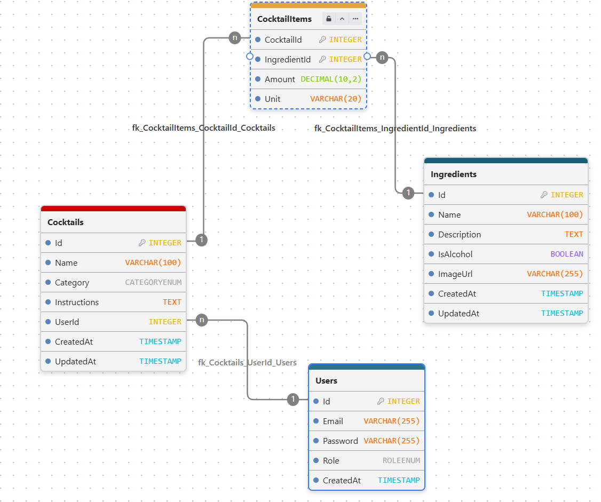

 <div align="center">
  

# Cocktails REST API

**REST API for cocktails, ingredients, and drink recipes.**

  <p>
    
    
    
    
  </p>
</div>

---

Projekt rekrutacyjny na stanowisko Backend w Kole Naukowym **Solvro**.
<br>
Strona: https://solvro.pwr.edu.pl/pl/
<br>
Github: https://github.com/solvro

Aplikacja to w pełni funkcjonalne REST API do zarządzania bazą koktajli i ich składników, zaimplementowane w oparciu o framework **NestJS**, bazę danych **PostgreSQL** oraz ORM **Prisma**.
<br>

## Technologie

- **Framework:** NestJS
- **Baza danych:** PostgreSQL
- **ORM:** Prisma
- **Uwierzytelnianie i Bezpieczeństwo:** Passport, Passport-JWT, bcrypt
- **Walidacja danych:** class-validator, class-transformer
- **Dokumentacja API:** Swagger / OpenAPI

## Schemat bazy danych

</img>

<br>

## Funkcjonalności API

### 1. Uwietrzlnianie i autoryzacja

- <b> Rejestracja użytkowników </b> - walidacją adresu email i haszowaniem hasła poprzez bcrypt.
- <b> Logowanie użytkowników </b> - sprawdzenie hasła, generowanie tokenów JWT
- <b> Role użytkowników i autoryzacja </b> - publiczny dostępn do przeglądania (GET), dodawanie nowych koktajli tylko dla zalogowanych, powiązanie koktajlu z autorem, tylko autor lub admin mogą usuwać/edytować dany koktajl.

### 2. Zarządzanie składnikami (INGREDIENTS)

- <b> Pełny CRUD </b>
- <b> Paginacja </b>
- <b> Blokada usunięcia składnika </b> - jeśli jest on powiązany z jakimkolwiek istniejącym koktajlem
- <b> Wyszukiwanie składników po nazwie lub opisie </b>
- <b> Filtrowanie składników alkoholowych i bezalkoholowych </b>
- <b>Możliwość sortowania po nazwie lub dacie utworzenia oraz kierunku</b>
- <b> Wszystkie filtry można stosować jednocześnie </b>

### 3. Zarządzanie koktajlami i przepisami (COCKTAILS)

- <b> Pełny CRUD </b>
- <b> Paginacja </b>
- <b> Obsługa tabeli CocktailItems zawierającej amount i unit </b>
- <b> Przypisywanie tworzonego koktajlu do zalogowanego użytkownika</b>
- <b> Filtorwanie po kategorii koktajlu, nazwie lub instrukcji</b>
- <b> Filtorwanie koktajli po id lub nazwie składnika</b>
- <b> Filtorwanie koktajli alkoholowych i bezalkoholowych</b>
- <b> Filtorwanie koktajli po adresie email autora </b>
- <b> Sortowanie wyników po nazwie lub dacie utworzenia w wybranym kierunku </b>
- <b> Wszystkie filtry można stosować jednocześnie </b><br>
  `GET /cocktails?category=LONG_DRINK&ingredientName=mięta&isAlcoholic=false&authorEmail=user1@solvro.pl`

### 4. Automatyczne seedowanie bazy danych - npx prisma db seed

- 3 konta testowe: admin, user1 (autor drinków), user2
- 5 koktajli z różnymi składnikami i kategoriami
- 13 składników (zarówno alkoholowych jak i bezalkoholowych)

### 5. Dokumentacja Swagger/OpenAPI pod adresem /api z obsługą autoryzacji tokenem JWT

<br>

## Uruchomienie projektu

### Wymagania

- Node.js (wersja 20+ zalecana)
- Zainstalowana i uruchomiona baza PostgreSQL (np. lokalnie lub w kontenerze Docker)
<br>

<br>

```bash
### 1. Klonowanie i instalacja zależności
git clone <URL_REPOZYTORIUM>
cd <NAZWA_KATALOGU>
npm install

### 2. Plik .env

DATABASE_URL="postgresql://postgres:<HASLO>@localhost:5432/cocktail_db?schema=public"

### 3. Migracja bazy danych

npx prisma migrate dev

### 4. Seedowanie bazy danych

npx prisma db seed

### 5. Start aplikacji

npm run start

### 6. Link

Aplikacja - http://localhost:3000
API DOCS - http://localhost:3000/api

```
